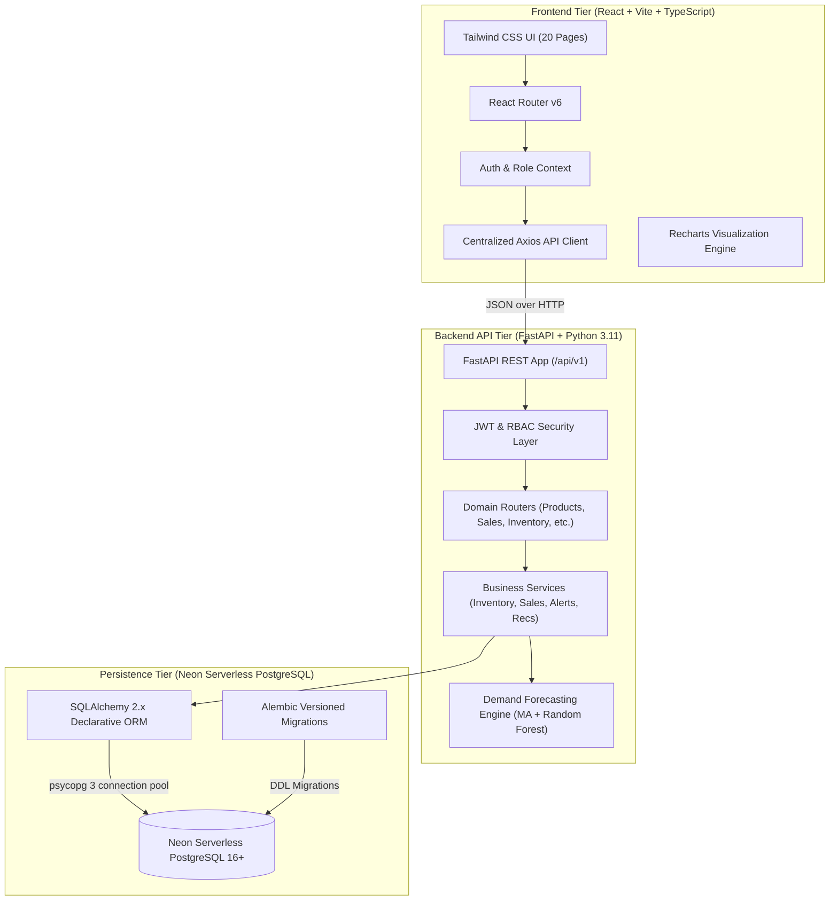

# StockSense Architecture Specification

## 1. System Overview
**StockSense** is a modern, full-stack inventory management, batch expiry tracking, and demand forecasting web application tailored for small retailers (grocery stores, pharmacies, general merchants).
It integrates deterministic **FEFO (First Expired, First Out)** stock allocation, moving-average and Random Forest demand projection, replenishment reordering recommendations, and audit movement ledgers.

---

## 2. Layered Architecture

---

## 3. Core Subsystems

### 3.1. Inventory & FEFO Allocation Engine
- **Perishable Batch Tracking**: Each product can have multiple distinct inventory batches with individual lot numbers, received dates, costs, and expiry dates.
- **FEFO (First Expired, First Out)**: Sales orders prioritize candidate batches with the earliest expiry date (`expiry_date ASC NULLS LAST`), using received date and batch ID as tie-breakers.
- **Safety Exclusion**: Expired batches (`expiry_date < today`) are automatically excluded from sale fulfillment and quarantined.
- **Atomic Allocation**: In a single database transaction, stock is verified, batches are decremented, status transitioned to `depleted` when reaching 0, and immutable `StockMovement` ledger entries are written.

### 3.2. Demand Forecasting Pipeline
- **Continuous Historical Series**: Historical daily sales are aggregated over 30/60/90 days. Zero-sales days during in-stock periods are explicitly represented as 0.0 rather than omitted.
- **Baseline Model**: Moving Average (7-day or 14-day rolling window) with non-negative projection constraints.
- **Advanced Model**: Scikit-Learn Random Forest Regressor leveraging day-of-week, lag sales (lag 1, lag 2, lag 7), and rolling mean/std statistics. Uses time-ordered splits (80% train, 20% test) to prevent future data leakage.
- **Evaluation**: Out-of-sample backtesting reported via Mean Absolute Error (MAE) and Root Mean Squared Error (RMSE).

### 3.3. Reorder Recommendation Engine
- **Formula**:
  $$\text{Reorder Point} = (\text{Daily Demand} \times \text{Lead Time}) + \text{Safety Stock}$$
  $$\text{Suggested Order Quantity} = \max(0, \text{Target Stock} - \text{Current Stock})$$
- Safety stock dynamically scales with demand volatility during vendor lead times.

### 3.4. Real-Time Alert Engine
- **Low Stock**: Triggered when eligible available units $\le$ product reorder threshold.
- **Near Expiry**: Triggered when lot expiry date falls within configurable warning window (default: 30 days).
- **Expired Stock**: Immediate critical flag for batches past expiration with unsold units.
- **Deduplication & Auto-Reconciliation**: Resolves alerts automatically when stock is replenished or expired lots are disposed.
