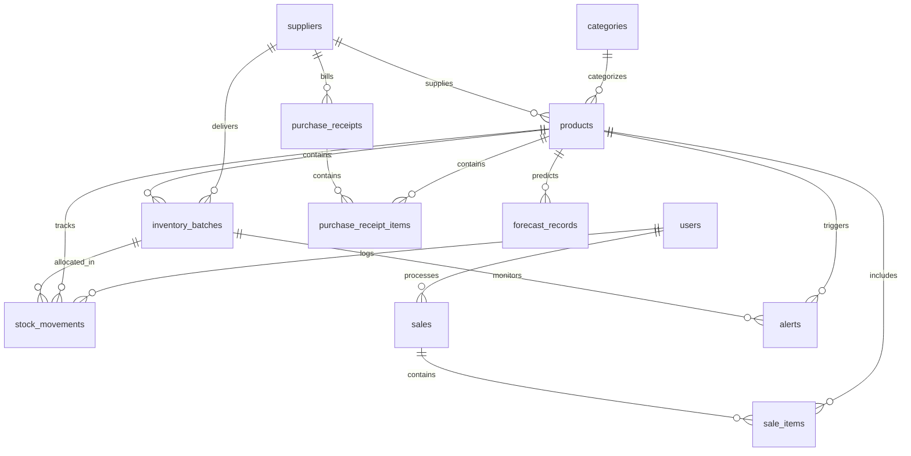

# StockSense Database Schema Documentation

## 1. Overview & Engine Specification
- **Database Engine**: PostgreSQL 16+ on **Neon Serverless PostgreSQL**.
- **Driver**: `psycopg` (psycopg 3) with `postgresql+psycopg://` URI scheme.
- **Connection Pooling**: Configured with `pool_pre_ping=True`, `pool_recycle=300`, `pool_size=10`, `max_overflow=20` to gracefully handle serverless idle timeouts and cold starts.
- **Migrations**: Alembic (`backend/alembic`).

---

## 2. Entity Relationship Diagram

---

## 3. Detailed Table Definitions

### 3.1. `users`
| Column | Type | Constraints | Description |
|---|---|---|---|
| `id` | INTEGER | PRIMARY KEY | Unique user ID |
| `email` | VARCHAR(255) | UNIQUE, NOT NULL, INDEX | Login email |
| `hashed_password` | VARCHAR(255) | NOT NULL | Bcrypt hashed credential |
| `full_name` | VARCHAR(255) | NOT NULL | User display name |
| `role` | VARCHAR(50) | NOT NULL, DEFAULT 'staff' | `'shop_owner'` or `'staff'` |
| `is_active` | BOOLEAN | NOT NULL, DEFAULT true | Account status flag |
| `created_at` | TIMESTAMPTZ | NOT NULL, server_default now() | Creation timestamp |
| `updated_at` | TIMESTAMPTZ | NOT NULL, server_default now() | Last update timestamp |

### 3.2. `categories`
| Column | Type | Constraints | Description |
|---|---|---|---|
| `id` | INTEGER | PRIMARY KEY | Unique category ID |
| `name` | VARCHAR(100) | UNIQUE, NOT NULL, INDEX | Category name |
| `description` | TEXT | NULLABLE | Category description |
| `created_at` | TIMESTAMPTZ | NOT NULL, server_default now() | Creation timestamp |

### 3.3. `suppliers`
| Column | Type | Constraints | Description |
|---|---|---|---|
| `id` | INTEGER | PRIMARY KEY | Unique supplier ID |
| `name` | VARCHAR(255) | NOT NULL, INDEX | Vendor or company name |
| `contact_name` | VARCHAR(255) | NULLABLE | Sales representative |
| `email` | VARCHAR(255) | NULLABLE | Contact email |
| `phone` | VARCHAR(50) | NULLABLE | Phone contact |
| `address` | TEXT | NULLABLE | Depot / warehouse location |
| `lead_time_days` | INTEGER | NOT NULL, DEFAULT 7 | Replenishment lead time in days |
| `created_at` | TIMESTAMPTZ | NOT NULL, server_default now() | Registration date |

### 3.4. `products`
| Column | Type | Constraints | Description |
|---|---|---|---|
| `id` | INTEGER | PRIMARY KEY | Unique product ID |
| `name` | VARCHAR(255) | NOT NULL, INDEX | Product name |
| `sku` | VARCHAR(100) | UNIQUE, NOT NULL, INDEX | Stock keeping unit code |
| `barcode` | VARCHAR(100) | NULLABLE, INDEX | EAN / UPC barcode |
| `category_id` | INTEGER | FOREIGN KEY (`categories.id`) | Product category |
| `supplier_id` | INTEGER | FOREIGN KEY (`suppliers.id`) | Primary vendor |
| `description` | TEXT | NULLABLE | Specifications / storage notes |
| `unit` | VARCHAR(50) | NOT NULL, DEFAULT 'unit' | Measurement unit (pcs, kg, litre, etc.) |
| `purchase_cost` | NUMERIC(12, 2)| NOT NULL, DEFAULT 0.00 | Latest purchase cost per unit |
| `selling_price` | NUMERIC(12, 2)| NOT NULL, DEFAULT 0.00 | Retail selling price |
| `reorder_threshold`| INTEGER | NOT NULL, DEFAULT 10 | Reorder point alert trigger |
| `is_active` | BOOLEAN | NOT NULL, DEFAULT true | Active status flag |
| `created_at` | TIMESTAMPTZ | NOT NULL, server_default now() | Registration timestamp |
| `updated_at` | TIMESTAMPTZ | NOT NULL, server_default now() | Modification timestamp |

### 3.5. `inventory_batches`
| Column | Type | Constraints | Description |
|---|---|---|---|
| `id` | INTEGER | PRIMARY KEY | Unique batch ID |
| `product_id` | INTEGER | FOREIGN KEY (`products.id`) | Linked product |
| `supplier_id` | INTEGER | FOREIGN KEY (`suppliers.id`) | Sourcing supplier |
| `batch_number` | VARCHAR(100) | NOT NULL, INDEX | Lot / Batch identifier |
| `quantity_received`| INTEGER | NOT NULL | Initial intake volume |
| `current_quantity`| INTEGER | NOT NULL, DEFAULT 0, INDEX | Available on-hand quantity |
| `received_date` | DATE | NOT NULL | Intake date |
| `expiry_date` | DATE | NULLABLE, INDEX | Expiration date (null for non-perishable) |
| `unit_cost` | NUMERIC(12, 2)| NOT NULL | Batch purchase cost snapshot |
| `status` | VARCHAR(50) | NOT NULL, DEFAULT 'active' | `'active'`, `'depleted'`, `'expired'` |
| `created_at` | TIMESTAMPTZ | NOT NULL, server_default now() | Record creation date |

### 3.6. `stock_movements`
| Column | Type | Constraints | Description |
|---|---|---|---|
| `id` | INTEGER | PRIMARY KEY | Unique movement ID |
| `product_id` | INTEGER | FOREIGN KEY (`products.id`) | Linked product |
| `batch_id` | INTEGER | FOREIGN KEY (`inventory_batches.id`)| Linked batch |
| `movement_type` | VARCHAR(50) | NOT NULL, INDEX | `purchase_receipt`, `sale`, `customer_return`, `damaged_stock`, `expired_removal`, `manual_adjustment` |
| `quantity` | INTEGER | NOT NULL | Signed delta (+ for intake, - for sale) |
| `reference_id` | VARCHAR(100) | NULLABLE, INDEX | Sale # or Receipt # |
| `reason` | TEXT | NULLABLE | Auditable description |
| `user_id` | INTEGER | FOREIGN KEY (`users.id`) | Responsible user |
| `created_at` | TIMESTAMPTZ | NOT NULL, server_default now() | Movement timestamp |

### 3.7. `sales` and `sale_items`
- `sales` records financial summaries: `sale_number`, `subtotal`, `discount_amount`, `total_amount`, `total_cost`, `gross_profit`, `payment_method`, `status` (`completed`, `cancelled`).
- `sale_items` snapshots historical prices and costs per allocated batch slice: `line_subtotal`, `line_cost`, `line_profit`.

### 3.8. `alerts` and `app_settings`
- `alerts`: records deduplicated alerts (`low_stock`, `near_expiry`, `expired`), severity, read/resolved timestamps.
- `app_settings`: stores configurable business rules (`near_expiry_days`, `currency_symbol`, `default_lead_time_days`).
